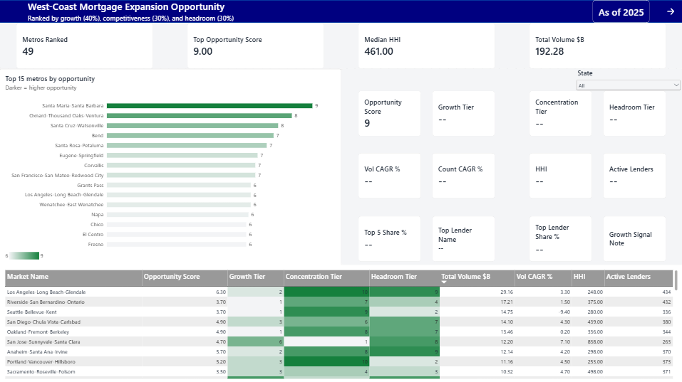
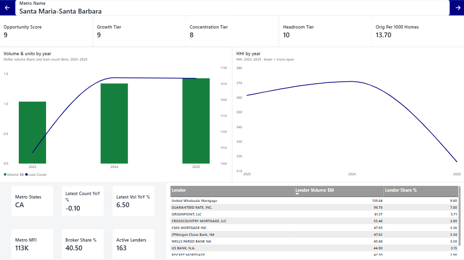
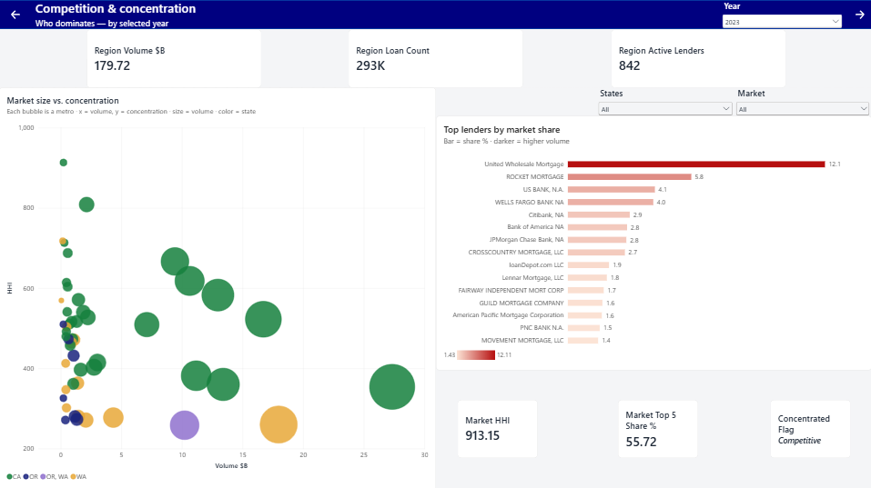
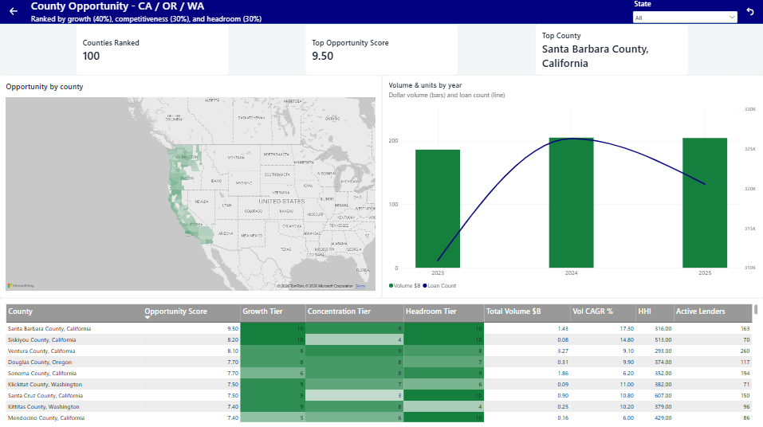

# West-Coast Mortgage Expansion Opportunity: A Market-Share Analysis of CA / OR / WA

**Which metros and counties in California, Oregon, and Washington offer the best opportunity for a mortgage lender to expand and why.**

---

## Overview

A lender choosing where to grow faces roughly 50 West-Coast metros. Volume follows population, but *opportunity* does not: the biggest markets are often the most crowded, and raw loan counts say nothing about where demand is still expanding or where incumbents have the market locked up.

This project measures opportunity directly. Using 958,408 home-purchase loan originations from the public HMDA dataset (CA / OR / WA, 2023–2025), it builds a single, defensible **opportunity score** for every metro and county, combining demand growth, competitive openness, and unrealized headroom. The analysis is built in DuckDB (SQL) and delivered as a four-page interactive Power BI dashboard. It identifies:

- **Where the opportunity is:** Growing secondary metros (Santa Maria-Santa Barbara, Oxnard-Thousand Oaks-Ventura, Santa Cruz-Watsonville, Bend (OR), and Santa Rosa-Petaluma) top the ranking
- **Where it isn't:** Los Angeles and the Bay Area are large but mature. Their low concentration reflects a crowded, hard-to-win field, not open room to grow
- **How concentrated the region is:** Median metro HHI = 461,  well below the DOJ "highly concentrated" threshold of 1,800
- **Who leads:** United Wholesale Mortgage (~9.7% of regional purchase volume in 2025) and Rocket Mortgage (~5.7% in 2025).
- **The market size:** ~$192B in purchase-loan volume across the three states in the latest year (2025).

## Key Findings

### The Opportunity Is in Growing Secondary Markets, Not the Giants

| Finding | Detail |
|---------|--------|
| **49 metros and 100 counties** scored across CA / OR / WA | Ranked on a single composite opportunity score (Originally 50 metros and 133 counties before floors and ceilings on lenders and loans) |
| **Top markets are secondary growth metros** | Coastal and inland secondary metros outrank LA and the Bay Area |
| **The giants are mature, not open** | LA / Bay low HHI = crowded & competitive, not under-served |
| **The region is unconcentrated** | Median metro HHI = 461 (DOJ "highly concentrated" = 1,800+) |
| **No single lender dominates** | Leader (UWM) holds under 10% of regional purchase volume |
| **Growth measured on multi-year CAGR** | Floored at ≥ 15 active lenders and ≥ 200 loans to remove noise |

### Top Opportunity Metros (2025 — "Strong" Tier)

| Rank | Metro | Opportunity Score | Profile |
|------|-------|-------------------|---------|
| 1 | Santa Maria-Santa Barbara, CA | 9.0 | High growth, open market, strong headroom |
| 2 | Oxnard-Thousand Oaks-Ventura, CA | 8.1 | Growing, contestable coastal market |
| 3 | Santa Cruz-Watsonville, CA | 7.5 | High growth and headroom |
| 4 | Bend, OR | 7.3 | Fastest demand growth in the set |
| 5 | Santa Rosa-Petaluma, CA | 7.0 | Steady growth, open field |
| 6 | Eugene-Springfield, OR | 6.6 | Secondary metro with room to grow |
| 7 | Corvallis, OR | 6.5 | Small but under-penetrated |
| 8 | San Francisco-San Mateo-Redwood City, CA | 6.5 | Large volume, selective headroom |
| 9 | Grants Pass, OR | 6.3 | High growth, low penetration |

The full ranking for all metros and counties is explorable in the dashboard.

---

## Methodology

### Core Metric: The Opportunity Score

Each market receives three tiers (scored between 1–10), combined into a weighted composite:

```
opportunity_score = 0.4 × growth_tier      (demand growth -> volume CAGR & count CAGR, 2023 -> 2025)
                  + 0.3 × concentration_tier     (low HHI = contestable market)
                  + 0.3 × headroom_tier     (originations per 1000 homes)
```

Growth uses **CAGR** across the full window rather than a single year-over-year change, so the signal reflects a sustained trajectory, not one noisy year. Concentration scores *lower* HHI *higher*. A deliberate contestability choice: a fragmented market has no entrenched player to displace, which is what correctly surfaces growing secondary metros over the crowded giants.

### Scope: The `base` Population

Scoping is **structural, not by arbitrary cap**,  defined by what a consumer home-purchase loan *is*:

| Filter | Keeps |
|--------|-------|
| `action_taken = 1` | Originations only |
| `loan_purpose = 1` | Home purchase (not refinance / improvement) |
| `occupancy_type = 1` | Owner-occupied |
| `total_units IN (1–4)` | 1-to-4 family dwellings |
| `lien_status = 1` | First lien |
| `open_end_line_of_credit = 2` | Closed-end |
| `reverse_mortgage = 2` | Not reverse |
| `business_or_commercial_purpose = 2` | Consumer |
| `derived_msa_md IS NOT NULL` | Has a metro (primary market grain) |

This structural scope also removes the multi-hundred-million-dollar "loans" in the raw data. They were multifamily and commercial records, excluded by definition rather than by a threshold.

### Metric Suite

| Metric | Purpose | Definition |
|--------|---------|------------|
| **Opportunity score** | The composite ranking | 0.4 growth + 0.3 concentration + 0.3 headroom |
| **Growth (CAGR)** | Demand expansion | 0.2 Volume CAGR + 0.2 loan-count CAGR, 2023→2025 |
| **Concentration (HHI)** | Market contestability | Herfindahl-Hirschman Index; lower → higher tier |
| **Headroom (penetration)** | Unrealized demand | Originations per 1,000 existing 1-to-4 family homes |
| **Lender share / Top-5 share** | Who dominates | Share of market volume by LEI |
| **Broker / correspondent mix** | Channel structure | Share submitted through brokers vs. retail |
| **Ranking floors** | Noise control | Market ranked only if ≥ 15 lenders and ≥ 200 loans |

### Key Analytical Decisions

The full decision log is in [`DECISIONS.md`](DECISIONS.md). The ones that most shape the result:

- **Lender identity is keyed on LEI, never on name.** Names drift and collide (ten independent "First State Banks" share one name). A full reconciliation confirmed no large lender is split across LEIs, so lenders stay distinct by LEI with one canonical name each. One sizable unmatched LEI was identified and named via the GLEIF registry.
- **A missing value excludes a record from the one metric that needs it, never drops the record.** HMDA missingness is tied to lender size (small, partially-exempt filers), so dropping rows would systematically delete small lenders and *inflate* apparent concentration. Grounded in the actual Regulation C reporting rules.
- **A mid-window MSA boundary change was caught and handled.** A validation check flagged a 2023 -> 2024 Seattle-area metro re-code (a division split). Because county FIPS codes are stable, those markets are analyzed at the county grain.

---

## Data Sources

| Dataset | Source | Grain | Coverage |
|---------|--------|-------|----------|
| Loan-level originations | HMDA Data Browser (CFPB/FFIEC) | Loan | CA / OR / WA, 2023–2025 |
| Lender panel (LEI → name) | HMDA Data Publication (CFPB/FFIEC) | Institution-year | National, 2023–2025 |
| MSA/ MD codes → metro names | IPUMS & Bureau of Labor Statistics | Metro | National |
| County FIPS → county names | U.S. Census | County | National |
| Entity-name verification | GLEIF LEI registry | Legal entity | As needed |

All data is publicly available. Raw HMDA files are large and **not committed**; download instructions are in the Reproducing section. Final analytical outputs are exported to `data/exports/` as Parquet.

---

## Repository Structure

```
mortgage-opportunity/
├── sql/
│   ├── 01_load.sql              # Load CA/OR/WA HMDA + panel; cache as Parquet
│   ├── 02_profile.sql           # Profile raw data before trusting it
│   ├── 03_lenders.sql           # One canonical name per LEI + overrides
│   ├── 04_base.sql              # Scoped, typed loan population (base view) + EDA
│   ├── 05_market_metrics.sql    # Market size, lender share (metro + county)
│   ├── 06_opportunity.sql       # Concentration, context, penetration, score
│   ├── 07_validate.sql          # Assertion checks (return rows only on failure)
    ├── 08_mapping.sql           # Connecting MSA/MD & county codes to names
│   └── 08_export.sql            # Export final views to Parquet for Power BI
│
├── dashboards/
│   ├── mortgage_opportunity.pbix
│   ├── page1_opportunity.png
│   ├── page2_metro_detail.png
│   ├── page3_competition.png
│   └── page4_county_view.png
│
├── data/
│   ├── raw/                     # HMDA + panel CSVs (not committed)
│   ├── processed/               # HMDA raw parqet file
│   └── exports/                 # Parquet outputs consumed by Power BI (not committed)
│
├── docs/
│   ├── DECISIONS.md                        # Full methodology & decision log
│   ├── DEVLOG.md                           # Personal log of progress throught the project (not committed)
│   ├── hmda_filing_instructions_guide.pdf  # The 2026 HMDA filing instructions document (provided by the FFIEC)
│   └── public_hmda_data_dictionary.pdf     # The HMDA data dictionary (provided by the FFIEC)
├── .gitattributes
├── .gitignore                              
├── mortgage.duckdb                         # Local DuckDB database built by the sql/ pipeline (not committed)
└── README.md                               

```

---

## Reproducing the Analysis

### Requirements

```
DuckDB (CLI or Python)
Power BI Desktop (free, Windows) — for the dashboard
HMDA loan files + lender panel in data/raw/  (see below)
```

### Steps

```bash
# 1. Download the source data into data/raw/
#    - Loan files (CA, OR, WA × 2023, 2024, 2025) from the HMDA Data Browser
#    - The lender panel / Transmittal Sheet from HMDA Data Publication

# 2. Run the pipeline in order
duckdb mortgage.duckdb < sql/01_load.sql
duckdb mortgage.duckdb < sql/02_profile.sql
duckdb mortgage.duckdb < sql/03_lenders.sql
duckdb mortgage.duckdb < sql/04_base.sql
duckdb mortgage.duckdb < sql/05_market_metrics.sql
duckdb mortgage.duckdb < sql/06_opportunity.sql
duckdb mortgage.duckdb < sql/07_validate.sql   # every check returns 0 rows = passing
duckdb mortgage.duckdb < sql/08_mapping.sql
duckdb mortgage.duckdb < sql/09_export.sql

# 3. Open dashboards/mortgage_opportunity.pbix and refresh
#    against data/exports/*.parquet
```

`07_validate.sql` is a suite of assertions that **return rows only on failure**. A clean run returns nothing from every check, covering row-count reconciliation, lender-join integrity (no row fan-out), metric bounds (HHI in range, shares sum to 100%), floor enforcement, and full year/market coverage.

---

## Interactive Dashboard

A four-page Power BI dashboard provides an interactive interface for exploring opportunity across every West-Coast metro and county.

### Page 1 — Opportunity Overview
The ranked answer: metros sorted by opportunity score, with a detail pane and the full ranked table.



### Page 2 — Metro Detail
Drill into any metro (via drill-through) for its volume and concentration trajectory, top lenders, and channel mix.



### Page 3 — Competition & Concentration
Who dominates, and how open each market is — a size-vs-concentration scatter plus per-market lender share for a selected year.



### Page 4 — County View
The geographic drill-down: a county choropleth shaded by opportunity, with a ranked county table.



> Download `dashboards/mortgage_opportunity.pbix` and open in [Power BI Desktop](https://powerbi.microsoft.com/desktop/) (free) for full interactivity.

---

## Limitations

- **Annual snapshot.** HMDA releases annually; figures are current through 2025 and are not live.

- **Tract-based penetration slightly under-covers rural counties.** Census tract is not reported for counties under 30,000 population (Regulation C §1003.4(a)(9)), so penetration in those areas is approximate.

- **Affiliate LEIs treated as distinct.** Lenders filing under separate affiliate LEIs are kept separate — a conservative choice, verified against the top 25 originators to have no material effect on concentration.

- **County income is applicant-reported.** HMDA has no county-level area-income field, so county median income uses applicant-reported income rather than an area statistic.

- **Opportunity score is a composite, not a forecast.** It ranks current conditions (growth, openness, headroom); it does not model future demand or returns.

---

## References

- Consumer Financial Protection Bureau / FFIEC. *HMDA Data Browser.* https://ffiec.cfpb.gov/data-browser/
- Consumer Financial Protection Bureau / FFIEC. *HMDA Data Publication (Snapshot & Panel).* https://ffiec.cfpb.gov/data-publication/
- Consumer Financial Protection Bureau. *Regulation C (12 CFR Part 1003).* https://www.consumerfinance.gov/rules-policy/regulations/1003/
- Global Legal Entity Identifier Foundation (GLEIF). *LEI Records.* https://search.gleif.org
- U.S. Census Bureau. *Core Based Statistical Area (CBSA) Delineation Files. https://www2.census.gov/programs-surveys/decennial/2010/partners/pdf/FIPS_StateCounty_Code.pdf

---

*Built by Ricardo Sanchez · [github.com/rsanchez02428](https://github.com/rsanchez02428)*
